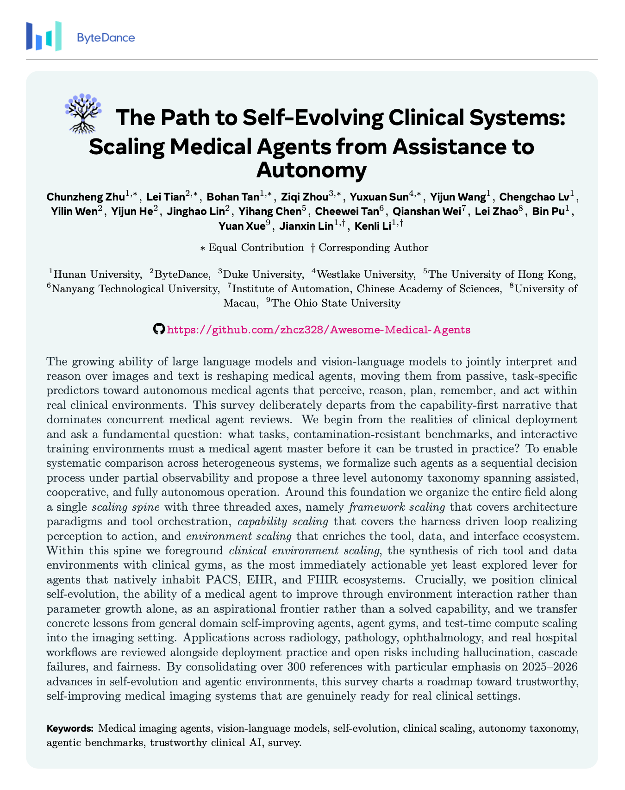
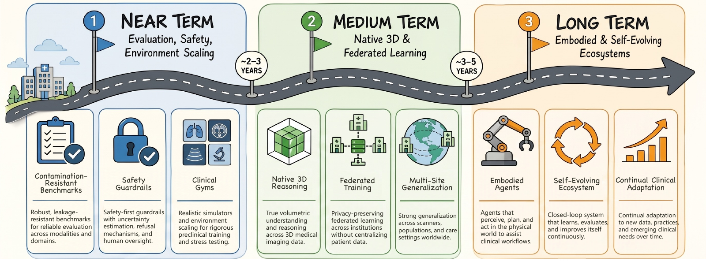
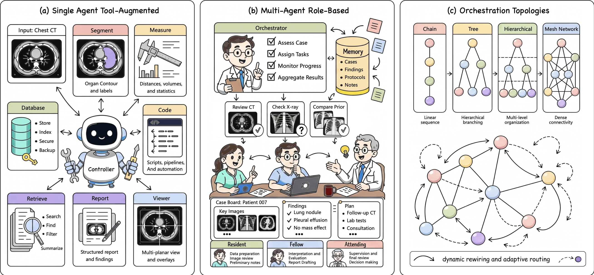
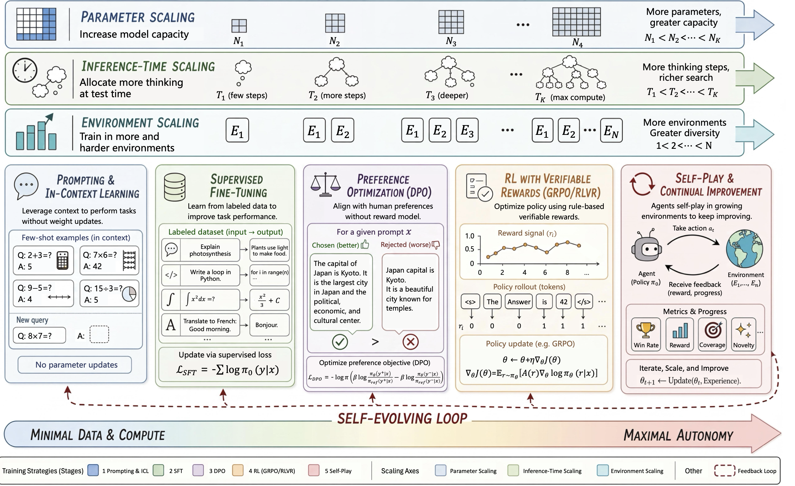
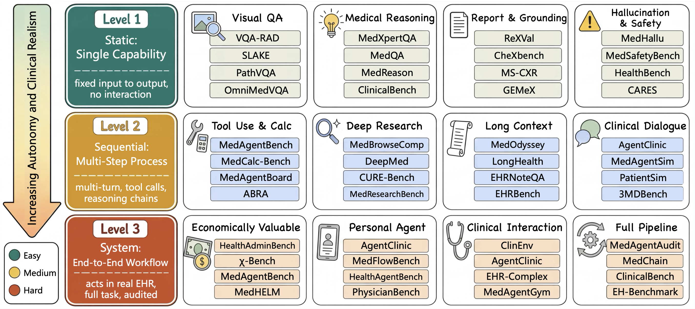
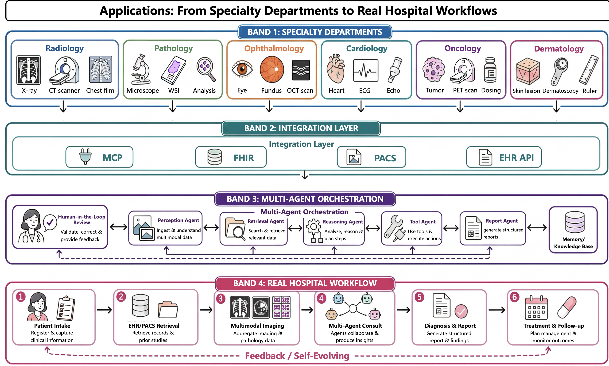

# Awesome-Medical-Agents

<div align="center">
    <a href="https://awesome.re"></a>
    <a href="https://github.com/zhcz328/Awesome-Medical-Agents/pulls"></a>
    <a href="https://arxiv.org/abs/2607.11175"></a>
    <a href="https://github.com/zhcz328/Awesome-Medical-Agents/stargazers"></a>
</div>

This repository provides a curated collection of research papers, benchmarks, and open-source projects on **medical agents**. It accompanies our survey 📖 *[**The Path to Self-Evolving Clinical Systems: Scaling Medical Agents from Assistance to Autonomy**](https://arxiv.org/abs/2607.11175)* and includes research published after the survey's original search window.

🤗 **Contributions are welcome!** To suggest a paper, benchmark, or repository, please [open an issue](https://github.com/zhcz328/Awesome-Medical-Agents/issues) or [submit a pull request](https://github.com/zhcz328/Awesome-Medical-Agents/pulls).

📫 **Contact:** Please use [GitHub Issues](https://github.com/zhcz328/Awesome-Medical-Agents/issues) for feedback, corrections, and suggestions.

**📃 Please [cite our paper](#-citation)** if you find the survey or repository useful!

```bibtex
@article{zhu2026path,
  title={The Path to Self-Evolving Clinical Systems: Scaling Medical Agents from Assistance to Autonomy},
  author={Zhu, Chunzheng and Tian, Lei and Tan, Bohan and Zhou, Ziqi and Sun, Yuxuan and Wang, Yijun and Lv, Chengchao and Wen, Yilin and He, Yijun and Lin, Jinghao and Chen, Yihang and Tan, Cheewei and Wei, Qianshan and Zhao, Lei and Pu, Bin and Li, Kenli and Xue, Yuan and Lin, Jianxin},
  journal={arXiv preprint arXiv:2607.11175},
  year={2026},
  url={https://arxiv.org/abs/2607.11175}
}
```

---

# 🎉 News

- **[2026-11]** Refreshed the reading list and added recent resources including [MedUIGym](https://arxiv.org/abs/2611.30983), [NPCBench](https://arxiv.org/abs/2611.08369), and [ClinVerse](https://arxiv.org/abs/2610.34878).
- **[2026-07]** Released the [medical agents survey](https://arxiv.org/abs/2607.11175).

---

<div align="center">
  <p></p>
  <p><em>An Overview of Medical Agents: From Assistance to Autonomy.</em></p>
</div>

The survey organizes medical agents by the scope of their autonomy:

- **L1 — Assisted:** The agent supports isolated tasks; clinicians confirm decisions.
- **L2 — Cooperative:** The agent plans multistep tasks and uses tools with people in the loop.
- **L3 — System-level autonomy:** The agent performs end-to-end workflows in the evaluated environment, with escalation and oversight defined by the setting.

See the [survey notes](docs/survey-notes.md) for the full taxonomy, methodology, evaluation criteria, and deployment considerations.

## 📈 Trends

<div align="center">
  <p></p>
  <p><em>A Roadmap for Scaling Medical Agents from Assistance to Autonomy.</em></p>
</div>

- **Framework scaling:** From single-agent tool use to orchestration and specialized teams.
- **Capability scaling:** From single-pass inference to perception, planning, execution, and reflection.
- **Environment scaling:** From static datasets to interactive EHRs, imaging viewers, and longitudinal clinical simulations.

---

## Table of Content
- [🎉 News](#-news)
- [📈 Trends](#-trends)
- [Survey Notes](docs/survey-notes.md)
- [📚 Related Survey Papers](#-related-survey-papers)
- [📜 Research Papers](#-research-papers)
    - [Core Capability Modules](#core-capability-modules)
        - [Medical Foundations and Perception](#medical-foundations-and-perception)
        - [Clinical Reasoning and Planning](#clinical-reasoning-and-planning)
        - [Memory, Tools, and Reflection](#memory-tools-and-reflection)
        - [Environment Scaling and Self-Improvement](#environment-scaling-and-self-improvement)
    - [Architecture Paradigms](#architecture-paradigms)
        - [Single-Agent and Code-as-Action](#single-agent-and-code-as-action)
        - [Multi-Agent and Adaptive Systems](#multi-agent-and-adaptive-systems)
    - [Training Strategies and Scaling](#training-strategies-and-scaling)
        - [Prompting, Fine-Tuning, and Alignment](#prompting-fine-tuning-and-alignment)
        - [Reinforcement Learning and Scaling](#reinforcement-learning-and-scaling)
    - [Evaluation and Safety](#evaluation-and-safety)
- [🏆 Benchmarks](#-benchmarks)
    - [Level 1: Isolated Single Capabilities](#level-1-isolated-single-capabilities)
    - [Level 2: Tool-Augmented and Interactive Agency](#level-2-tool-augmented-and-interactive-agency)
    - [Level 3: System-Level Clinical Operation](#level-3-system-level-clinical-operation)
- [💻 Open Source Libraries](#-open-source-libraries)
    - [Foundational Agent Orchestration](#foundational-agent-orchestration)
    - [Medical Models and Agent Frameworks](#medical-models-and-agent-frameworks)
    - [Evaluation and Training Environments](#evaluation-and-training-environments)
    - [Clinical Skills and Interoperability](#clinical-skills-and-interoperability)
- [🚀 Applications](#-applications)
    - [Medical Imaging and Specialty Care](#medical-imaging-and-specialty-care)
    - [Patient Consultation and Therapeutics](#patient-consultation-and-therapeutics)
    - [Clinical Records and Administration](#clinical-records-and-administration)
    - [Medical Research and Model Development](#medical-research-and-model-development)
- [🍀 Citation](#-citation)

# 📚 Related Survey Papers

- (arXiv 2025) A Survey of LLM-based Agents in Medicine: How far are we from Baymax? [[Paper]](https://arxiv.org/abs/2502.11211)
- Related reading lists: [Awesome-AI-Agents-for-Healthcare](https://github.com/AgenticHealthAI/Awesome-AI-Agents-for-Healthcare) · [Awesome-Multimodal-in-Medical-Imaging](https://github.com/richard-peng-xia/awesome-multimodal-in-medical-imaging)

# 📜 Research Papers

Papers are grouped by their role in the agent pipeline. `Code`, `Data`, `Model`, and `Project` identify different artifacts; a project page does not imply that implementation code is available.

## Core Capability Modules

### Medical Foundations and Perception

- (arXiv 2025) MedGemma: Open Medical Foundation Models [[Paper]](https://arxiv.org/abs/2507.05201)
- (arXiv 2025) Lingshu: A Generalist Foundation Model for Unified Multimodal Medical Understanding and Reasoning [[Paper]](https://arxiv.org/abs/2506.07044)
- (arXiv 2025) HealthGPT: A Medical Large Vision-Language Model [[Paper]](https://arxiv.org/abs/2502.09838)
- (arXiv 2025) InternVL3: Exploring Advanced Training and Test-Time Recipes for Open-Source Multimodal Models [[Paper]](https://arxiv.org/abs/2504.10479) [[Code]](https://github.com/OpenGVLab/InternVL)
- (arXiv 2025) Qwen3-VL: Multimodal Foundation Model for Visual Reasoning [[Paper]](https://arxiv.org/abs/2511.21631) [[Code]](https://github.com/QwenLM/Qwen3-VL)
- (NeurIPS 2023) LLaVA-Med: Training a Large Language-and-Vision Assistant for Biomedicine [[Paper]](https://arxiv.org/abs/2306.00890) [[Code]](https://github.com/microsoft/LLaVA-Med)
- (arXiv 2023) BiomedCLIP: Biomedical Contrastive Vision-Language Pretraining on 15M Pairs [[Paper]](https://arxiv.org/abs/2303.00915) [[Model]](https://huggingface.co/microsoft/BiomedCLIP-PubMedBERT_256-vit_base_patch16_224)
- (arXiv 2024) RAD-DINO: Scalable Medical Image Encoders Beyond Text Supervision [[Paper]](https://arxiv.org/abs/2401.10815) [[Model]](https://huggingface.co/microsoft/rad-dino)
- (Nature Medicine 2024) CONCH: A Visual-Language Foundation Model for Computational Pathology [[Paper]](https://arxiv.org/abs/2307.12914) [[Code]](https://github.com/mahmoodlab/CONCH)
- (CVPR 2024) InternVL: Scaling Vision Foundation Models [[Paper]](https://arxiv.org/abs/2312.14238) [[Code]](https://github.com/OpenGVLab/InternVL)
- (arXiv 2024) CheXagent: Towards a Foundation Model for Chest X-Ray Interpretation [[Paper]](https://arxiv.org/abs/2401.12208) [[Code]](https://github.com/Stanford-AIMI/CheXagent)
- (Nature Methods 2024) MedSAM: Segment Anything in Medical Images [[Paper]](https://www.nature.com/articles/s41592-024-02260-z) [[Code]](https://github.com/bowang-lab/MedSAM)
- (NeurIPS 2025) BTB3D: Better Tokens for Better 3D Vision-Language Modeling in Medical Imaging [[Paper]](https://arxiv.org/abs/2510.20639) [[Code]](https://github.com/ibrahimethemhamamci/BTB3D)
- (arXiv 2025) RadVLM: Multitask Conversational Vision-Language Model for Radiology [[Paper]](https://arxiv.org/abs/2502.03333) [[Code]](https://github.com/uzh-dqbm-cmi/RadVLM)
- (arXiv 2025) MedRAX: Medical Reasoning Agent for Chest X-ray [[Paper]](https://arxiv.org/abs/2502.02673) [[Code]](https://github.com/bowang-lab/MedRAX)
- (AAAI 2026) MedEyes: Learning Dynamic Visual Focus for Medical Progressive Diagnosis [[Paper]](https://ojs.aaai.org/index.php/AAAI/article/view/38401)

### Clinical Reasoning and Planning

- (Nature 2026) Towards conversational artificial intelligence for disease management — Google DeepMind and Google Research [[Paper]](https://www.nature.com/articles/s41586-026-10764-5) [[Project]](https://sites.research.google/gr/amie/)
- (NeurIPS 2024) MDAgents: An Adaptive Collaboration of LLMs for Medical Decision-Making [[Paper]](https://arxiv.org/abs/2404.15155) [[Code]](https://github.com/mitmedialab/MDAgents)
- (arXiv 2024) MedAgents: Large Language Models as Collaborators for Zero-shot Medical Reasoning [[Paper]](https://arxiv.org/abs/2311.10537) [[Code]](https://github.com/gersteinlab/MedAgents)
- (arXiv 2024) Med-Gemini: Capabilities of Gemini Models in Medicine [[Paper]](https://arxiv.org/abs/2404.18416)
- (arXiv 2025) MEDDxAgent: Unified Framework for Explainable Differential Diagnosis [[Paper]](https://arxiv.org/abs/2502.19175) [[Code]](https://github.com/nec-research/meddxagent)
- (arXiv 2025) MACD: Multi-Agent Clinical Diagnosis with Self-Learned Knowledge for LLMs [[Paper]](https://arxiv.org/abs/2509.20067) [[Code]](https://github.com/qjdzj/MACD-Multi-Agent-Clinical-Diagnosis-with-Self-Learned-Knowledge-for-LLM)
- (arXiv 2025) MedReason: Medical Reasoning with Knowledge Graph Grounding [[Paper]](https://arxiv.org/abs/2504.00993) [[Code]](https://github.com/UCSC-VLAA/MedReason)
- (arXiv 2025) MedVLM-R1: Incentivizing Medical Reasoning via Reinforcement Learning [[Paper]](https://arxiv.org/abs/2502.19634) [[Code]](https://github.com/JZPeterPan/MedVLM-R1)
- (arXiv 2026) CARE: Evidence-Grounded Agentic Reasoning for Medical VQA [[Paper]](https://arxiv.org/abs/2603.01607)
- (arXiv 2026) MedCausalX: Adaptive Causal Reasoning with Self-Reflection for Trustworthy Medical VLMs [[Paper]](https://arxiv.org/abs/2603.23085)
- (arXiv 2026) SEMA-RAG: Self-Evolving Multi-Agent Retrieval-Augmented Generation for Medical Reasoning [[Paper]](https://arxiv.org/abs/2605.17101)
- (arXiv 2026) From Conflict to Consensus: Boosting Medical Reasoning via Multi-Round Agentic RAG [[Paper]](https://arxiv.org/abs/2603.03292) [[Code]](https://github.com/NJU-RL/MA-RAG)
- (ACL 2026) Dialectic-Med: Mitigating Diagnostic Hallucinations via Counterfactual Adversarial Multi-Agent Debate [[Paper]](https://arxiv.org/abs/2604.11258)
- (arXiv 2025) MedAgent-Pro: Evidence-based Multi-modal Medical Diagnosis via Multi-agent Collaboration [[Paper]](https://arxiv.org/abs/2503.18968) [[Code]](https://github.com/jinlab-imvr/MedAgent-Pro)
- (arXiv 2025) MDTeamGPT: Self-evolving Multi-agent Framework for MDT Medical Consultation [[Paper]](https://arxiv.org/abs/2503.13856)
- (arXiv 2026) MedOpenClaw: Auditable VLM Agent for 3D Slicer Clinical Operations [[Paper]](https://arxiv.org/abs/2603.24649)
- (arXiv 2026) MACRO: Experience-Driven Self-Skill Discovery for Medical Imaging Agents [[Paper]](https://arxiv.org/abs/2603.05860)
- (arXiv 2026) MedExAgent: Training LLM Agents to Ask, Examine, and Diagnose in Noisy Clinical Environments [[Paper]](https://arxiv.org/abs/2605.07058)

### Memory, Tools, and Reflection

- (NeurIPS 2025) A-MEM: Agentic Memory for LLM Agents [[Paper]](https://arxiv.org/abs/2502.12110) [[Code]](https://github.com/agiresearch/A-mem)
- (EMNLP 2024) RULE: Reliable Multimodal RAG for Factuality in Medical VLMs [[Paper]](https://arxiv.org/abs/2407.05131) [[Code]](https://github.com/richard-peng-xia/RULE)
- (arXiv 2026) ClinicalAgents: Clinical Trial Multi-Agent System with Longitudinal Memory [[Paper]](https://arxiv.org/abs/2601.01170)
- (arXiv 2026) Detecting Clinical Discrepancies in Health Coaching Agents with Dual-Stream Memory [[Paper]](https://arxiv.org/abs/2604.27045)
- (ICLR 2024) ToolLLM: Mastering 16,000+ Real-World APIs [[Paper]](https://arxiv.org/abs/2307.16789) [[Code]](https://github.com/OpenBMB/ToolBench)
- (EMNLP 2024) EHRAgent: Code-empowered Tabular Reasoning on EHRs [[Paper]](https://arxiv.org/abs/2401.07128) [[Code]](https://github.com/wshi83/EhrAgent)
- (ACL 2025) ReflecTool: Reflection-Aware Tool-Augmented Clinical Agents [[Paper]](https://arxiv.org/abs/2410.17657) [[Code]](https://github.com/BlueZeros/ReflecTool)
- (arXiv 2026) ABRA: Agentic Benchmark for Radiology Assistant [[Paper]](https://arxiv.org/abs/2605.11224) [[Code]](https://github.com/Luab/ABRA)
- (arXiv 2026) Reinforcement Learning for Tool-Calling Agents in Fast Healthcare Interoperability Resources [[Paper]](https://arxiv.org/abs/2605.14126)
- (arXiv 2026) Empowering Locally Deployable Medical Agent via State Enhanced Logical Skills for FHIR-based Clinical Tasks [[Paper]](https://arxiv.org/abs/2603.06902)
- (arXiv 2025) MedAgentAudit: Auditing Collaborative Failure Modes in Medical Multi-Agent Systems [[Paper]](https://arxiv.org/abs/2510.10185) [[Code]](https://github.com/MedX-PKU/MedAgentAudit)
- (arXiv 2026) CareGuardAI: Context-Aware Multi-Agent Guardrails for Clinical Safety and Hallucination Mitigation [[Paper]](https://arxiv.org/abs/2604.26959)
- (arXiv 2026) CuraView: Multi-Agent Hallucination Detection with GraphRAG-Enhanced Knowledge Verification [[Paper]](https://arxiv.org/abs/2605.03476)

### Environment Scaling and Self-Improvement

- (arXiv 2026) EnvScaler: Scaling Tool-Interactive Environments for Agents [[Paper]](https://arxiv.org/abs/2601.05808) [[Code]](https://github.com/RUC-NLPIR/EnvScaler)
- (arXiv 2026) Evo-MedAgent: Evolutionary Agent Self-Improvement [[Paper]](https://arxiv.org/abs/2604.14475)

## Architecture Paradigms

<div align="center">
  <p></p>
  <p><em>Architecture Paradigms and Topologies for Medical Agents.</em></p>
</div>

### Single-Agent and Code-as-Action

- (arXiv 2024) CheXagent: Foundation Model for Chest X-Ray Interpretation [[Paper]](https://arxiv.org/abs/2401.12208) [[Code]](https://github.com/Stanford-AIMI/CheXagent)
- (arXiv 2025) MedRAX: Medical Reasoning Agent for Chest X-ray [[Paper]](https://arxiv.org/abs/2502.02673) [[Code]](https://github.com/bowang-lab/MedRAX)
- (arXiv 2024) MMedAgent: Learning to Use Medical Tools [[Paper]](https://arxiv.org/abs/2407.02483)
- (EMNLP 2024) EHRAgent: Code-empowered EHR Reasoning [[Paper]](https://arxiv.org/abs/2401.07128) [[Code]](https://github.com/wshi83/EhrAgent)
- (arXiv 2026) MedOpenCLAW / MedFlowBench: Auditing Medical Imaging Workflow Agents [[Paper]](https://arxiv.org/abs/2603.24649)
- (arXiv 2026) FastOMOP: Reliable Agentic Real-World Evidence Generation on OMOP CDM Data [[Paper]](https://arxiv.org/abs/2604.24572)

### Multi-Agent and Adaptive Systems

- (arXiv 2026) Towards Expert-level Medical AI for Real-time Video Consultations — Google Research and Google DeepMind [[Paper]](https://arxiv.org/abs/2608.09861) [[Project]](https://sites.research.google/gr/amie/)
- (NeurIPS 2024) MDAgents: Adaptive Collaboration of LLMs for Medical Decision-Making [[Paper]](https://arxiv.org/abs/2404.15155) [[Code]](https://github.com/mitmedialab/MDAgents)
- (arXiv 2024) MedAgents: LLM Collaborators for Medical Reasoning [[Paper]](https://arxiv.org/abs/2311.10537) [[Code]](https://github.com/gersteinlab/MedAgents)
- (arXiv 2025) MDTeamGPT: Multi-disciplinary Team Medical Consultation [[Paper]](https://arxiv.org/abs/2503.13856)
- (arXiv 2026) Meissa: Multi-modal Medical Agentic Intelligence [[Paper]](https://arxiv.org/abs/2603.09018) [[Code]](https://github.com/Schuture/Meissa)
- (arXiv 2026) XrayClaw: Cooperative-Competitive Multi-Agent Alignment for Trustworthy Chest X-ray Diagnosis [[Paper]](https://arxiv.org/abs/2604.02695)
- (ICML 2024) GPTSwarm: Language Agents as Optimizable Graphs [[Paper]](https://arxiv.org/abs/2402.16823) [[Code]](https://github.com/metauto-ai/GPTSwarm)
- (arXiv 2023) DyLAN: Dynamic LLM-Agent Network [[Paper]](https://arxiv.org/abs/2310.02170)
- (arXiv 2026) Evo-MedAgent: Evolutionary Agent Self-Improvement [[Paper]](https://arxiv.org/abs/2604.14475)
- (arXiv 2026) VERITAS: Multi-Agent Co-Scientist for Verifiable Image-Derived Hypothesis Testing [[Paper]](https://arxiv.org/abs/2604.12144) [[Code]](https://github.com/LucZot/veritas)

## Training Strategies and Scaling

<div align="center">
  <p></p>
  <p><em>Training Strategies and Scaling Paths for Medical Agents.</em></p>
</div>

### Prompting, Fine-Tuning, and Alignment

- (arXiv 2026) Agentic LLMs for Training-Free Neuro-Radiological Image Analysis [[Paper]](https://arxiv.org/abs/2604.16729)
- (arXiv 2024) Agent Hospital / MedAgent-Zero: Self-Evolution without Manual Labeling [[Paper]](https://arxiv.org/abs/2405.02957)
- (arXiv 2025) RadVLM: Multitask Conversational Fine-Tuning for Radiology [[Paper]](https://arxiv.org/abs/2502.03333) [[Code]](https://github.com/uzh-dqbm-cmi/RadVLM)
- (arXiv 2024) CheXagent: Clinical Knowledge Alignment, Finding Extraction, Report Generation [[Paper]](https://arxiv.org/abs/2401.12208) [[Code]](https://github.com/Stanford-AIMI/CheXagent)
- (CVPR 2025) OPA-DPO: On-Policy Alignment for Mitigating Hallucination in LVLMs [[Paper]](https://arxiv.org/abs/2501.09695) [[Code]](https://github.com/zhyang2226/OPA-DPO)

### Reinforcement Learning and Scaling

- (arXiv 2026) MedGRPO: Group Relative Policy Optimization for Medical Video Understanding [[Paper]](https://arxiv.org/abs/2512.06581)
- (arXiv 2025) MedVLM-R1: Incentivizing Medical Reasoning via Reinforcement Learning [[Paper]](https://arxiv.org/abs/2502.19634) [[Code]](https://github.com/JZPeterPan/MedVLM-R1)
- (Nature 2025) DeepSeek-R1: Incentivizing Reasoning in LLMs via Reinforcement Learning [[Paper]](https://arxiv.org/abs/2501.12948) [[Code]](https://github.com/deepseek-ai/DeepSeek-R1)
- (arXiv 2026) Evo-MedAgent: Iterative Self-Improvement Beyond One-Shot Diagnosis [[Paper]](https://arxiv.org/abs/2604.14475)
- (arXiv 2024) Scaling LLM Test-Time Compute Optimally can be More Effective than Scaling Model Parameters [[Paper]](https://arxiv.org/abs/2408.03314)
- (arXiv 2026) EnvScaler: Systematic Expansion of Tool-Interactive Environments [[Paper]](https://arxiv.org/abs/2601.05808) [[Code]](https://github.com/RUC-NLPIR/EnvScaler)
- (ICLR 2026) MedAgentGym: Scalable Agentic Training Environment for Biomedical Data Science [[Paper]](https://arxiv.org/abs/2506.04405) [[Code]](https://github.com/wshi83/MedAgentGym)

## Evaluation and Safety

- (arXiv 2026) Where Does Hindsight Enter Clinical Agent Benchmarks? An Audit of Simulators and Case Construction — The University of Hong Kong and City University of Hong Kong [[Paper]](https://arxiv.org/abs/2611.22241)

# 🏆 Benchmarks

<div align="center">
  <p></p>
  <p><em>A Three-Level Taxonomy for Evaluating Medical Agents.</em></p>
</div>

The levels describe the evaluation setting, from isolated capabilities to interactive and system-level tasks. See [evaluation metrics beyond accuracy](docs/survey-notes.md#evaluation-metrics-beyond-accuracy) for safety, robustness, and efficiency considerations.

## Level 1: Isolated Single Capabilities

| Name | Domain | Modality | Feature | Link | Paper |
| --- | --- | --- | --- | --- | --- |
| **HealthBench Professional** | Clinician chat tasks | Text | OpenAI · physician-authored and adjudicated rubrics for care consults, documentation and medical research | [📦 Data](https://openaipublic.blob.core.windows.net/simple-evals/healthbench_professional/assets.zip) | [[Paper]](https://arxiv.org/abs/2604.27470) |
| **CardioVascBench** | Cardiovascular diagnosis | Text / EHR | Sun Yat-sen University & Pengcheng Laboratory · prioritized differential diagnosis from Chinese clinical records | [💻 GitHub](https://github.com/muyaoc/CardioVascBench) · [📦 Data](https://openi.pcl.ac.cn/datasets/detail/cindyc/CardioVascBench) | [[Paper]](https://arxiv.org/abs/2611.04687) |
| **RADAR** | Report review | Text / Imaging | 3D radiology report discrepancy review | — | [[Paper]](https://arxiv.org/abs/2603.06681) |
| **MedXpertQA** | Medical QA | Text / Imaging | Expert-level text and multimodal medical reasoning | [🤗 HF](https://huggingface.co/datasets/TsinghuaC3I/MedXpertQA) | [[Paper]](https://arxiv.org/abs/2501.18362) |
| **MedHallu** | Factuality | Text | Medical hallucination detection benchmark | [🤗 HF](https://huggingface.co/datasets/UTAustin-AIHealth/MedHallu) | [[Paper]](https://arxiv.org/abs/2502.14302) |
| **HealthBench** | Health conversations | Text | Physician-rubric multiturn health conversations | [🤗 HF](https://huggingface.co/datasets/openai/healthbench) | [[Paper]](https://arxiv.org/abs/2505.08775) |
| **MedReason** | Medical reasoning | Text | Knowledge-graph grounded medical reasoning chains | [💻 GitHub](https://github.com/UCSC-VLAA/MedReason) | [[Paper]](https://arxiv.org/abs/2504.00993) |
| **GEMeX** | Image grounding | Text / Imaging | Grounded explainable chest X-ray VQA | [📦 Data](https://www.med-vqa.com/GEMeX) | [[Paper]](https://arxiv.org/abs/2411.16778) |
| **CheXbench** | Chest radiography | Text / Imaging | Chest X-ray perception and report understanding | [💻 GitHub](https://github.com/Stanford-AIMI/CheXagent) | [[Paper]](https://arxiv.org/abs/2401.12208) |
| **OmniMedVQA** | Medical VQA | Text / Imaging | Large-scale medical VQA across 12 modalities | [🤗 HF](https://huggingface.co/datasets/foreverbeliever/OmniMedVQA) | [[Paper]](https://arxiv.org/abs/2402.09181) |
| **MedSafetyBench** | Safety | Text | Medical safety benchmark with harmful requests | [💻 GitHub](https://github.com/AI4LIFE-GROUP/med-safety-bench) | [[Paper]](https://arxiv.org/abs/2403.03744) |
| **CARES** | Safety | Text / Imaging | Medical LVLM trustworthiness across reliability dimensions | [💻 GitHub](https://github.com/richard-peng-xia/CARES) | [[Paper]](https://arxiv.org/abs/2406.06007) |
| **ClinicalBench** | Clinical prediction | Text / Structured data | LLMs vs classical clinical prediction models | [💻 GitHub](https://github.com/canyuchen/ClinicalBench) | [[Paper]](https://arxiv.org/abs/2411.06469) |
| **ReXVal** | Report evaluation | Text | Radiologist error annotations for report evaluation | [📦 Data](https://physionet.org/content/rexval-dataset) | [[Paper]](https://physionet.org/content/rexval-dataset/1.0.0/) |
| **MedMCQA** | Medical QA | Text | Multi-subject medical multiple-choice QA | [🤗 HF](https://huggingface.co/datasets/openlifescienceai/medmcqa) | [[Paper]](https://arxiv.org/abs/2203.14371) |
| **MS-CXR** | Image grounding | Text / Imaging | Radiologist phrase grounding boxes for CXR | [📦 Data](https://physionet.org/content/ms-cxr) | [[Paper]](https://arxiv.org/abs/2204.09817) |
| **MedQA** | Medical QA | Text | Medical licensing exam QA | [🤗 HF](https://huggingface.co/datasets/GBaker/MedQA-USMLE-4-options) | [[Paper]](https://arxiv.org/abs/2009.13081) |
| **SLAKE** | Radiology VQA | Text / Imaging | Bilingual knowledge-enhanced radiology VQA | [🤗 HF](https://huggingface.co/datasets/mdwiratathya/SLAKE-vqa-english) | [[Paper]](https://arxiv.org/abs/2102.09542) |
| **PathVQA** | Pathology VQA | Text / Imaging | Pathology VQA with 32K questions over 5K images | [🤗 HF](https://huggingface.co/datasets/flaviagiammarino/path-vqa) | [[Paper]](https://arxiv.org/abs/2003.10286) |
| **PubMedQA** | Biomedical QA | Text | Biomedical yes/no/maybe reasoning over abstracts | [🤗 HF](https://huggingface.co/datasets/qiaojin/PubMedQA) | [[Paper]](https://arxiv.org/abs/1909.06146) |
| **VQA-RAD** | Radiology VQA | Text / Imaging | Clinician-generated radiology VQA | [🤗 HF](https://huggingface.co/datasets/flaviagiammarino/vqa-rad) | [[Paper]](https://www.nature.com/articles/sdata2018251) |

## Level 2: Tool-Augmented and Interactive Agency

| Name | Domain | Modality | Feature | Link | Paper |
| --- | --- | --- | --- | --- | --- |
| **ClinVerse** | Interactive diagnosis | Text / EHR | Fudan University, Zhejiang University & Shanghai Innovation Institute · multi-agent clinical simulation for history-taking and test selection | [💻 GitHub](https://github.com/SirryChen/ClinVerse) | [[Paper]](https://arxiv.org/abs/2610.34878) |
| **EHR-RobustGym** | Robust clinical reasoning | Text / EHR | Zhejiang University & Ant Group · robustness to noisy queries and evidence-grounded abstention | [🌐 Project](https://github.com/yitong-qiao/EHR-RobustGym) | [[Paper]](https://arxiv.org/abs/2609.39371) |
| **NPCBench** | Oncology care pathways | Text / Imaging | Hong Kong Polytechnic University, Sun Yat-sen University Cancer Center & collaborators · multimodal staging, management and specialist consultation | [💻 GitHub](https://github.com/pidneuralode/NPCBench) · [🤗 HF](https://huggingface.co/datasets/pengkaiScience/NPCBench) | [[Paper]](https://arxiv.org/abs/2611.08369) |
| **MedDialogRubrics** | Clinical dialogue | Text | Multiturn diagnostic consultation with rubrics | — | [[Paper]](https://arxiv.org/abs/2601.03023) |
| **MedMemoryBench** | Healthcare memory | Text | Agent memory in personalized healthcare | — | [[Paper]](https://arxiv.org/abs/2605.11814) |
| **AgentRx** | Clinical prediction | Multimodal | Single vs multi-agent multimodal clinical prediction | — | [[Paper]](https://arxiv.org/abs/2605.10286) |
| **DeepTumorVQA** | Tumor VQA | Text / Imaging | Hierarchical 3D CT tumor VQA for VLMs and tool-augmented agents | — | [[Paper]](https://arxiv.org/abs/2605.09679) |
| **MedProbeBench** | Medical guidelines | Text | Deep evidence integration for expert-level medical guideline reasoning | — | [[Paper]](https://arxiv.org/abs/2604.18418) |
| **ABRA** | Radiology workflows | GUI / Imaging | Radiology agent with OHIF, Orthanc, and 21 tools | [💻 GitHub](https://github.com/Luab/ABRA) | [[Paper]](https://arxiv.org/abs/2605.11224) |
| **AutoMedBench** | Medical research | Multimodal | Workflow-aware autonomous medical AI research | [💻 GitHub](https://github.com/automedbench/automedbench) | [[Paper]](https://arxiv.org/abs/2606.01961) |
| **DeepMed** | Medical web search | Text / Web | Medical deep-research agent with multi-hop search | — | [[Paper]](https://aclanthology.org/2026.findings-acl.904) |
| **MedResearchBench** | Clinical research | Text | Medical research agents on clinical research tasks | — | [[Paper]](https://www.medrxiv.org/content/10.64898/2026.03.30.26349749v1) |
| **EHRBench** | Clinical decisions | Text / EHR | EHR-grounded clinical decision making | — | [[Paper]](https://arxiv.org/abs/2605.30637) |
| **Patients With Personality (PWP)** | Patient simulation | Text | HEXACO-parametrized patient simulation with selective disclosure for doctor-LLM evaluation | [💻 GitHub](https://github.com/mo374z/PatientsWithPersonality) | [[Paper]](https://arxiv.org/abs/2606.17441) |
| **GPAgentBench-2K** | Primary care | Text | Primary-care GP consultation as a constrained MDP: 6 clinical actions, workflow prior, safety-informed referral | [💻 GitHub](https://github.com/jianing-lab/GPAgentBench) | [[Paper]](https://aclanthology.org/2026.emnlp-main.644.pdf) |
| **MedAgentBench** | Clinical EHR tasks | Text / API | FHIR-compliant virtual EHR agentic tasks | [💻 GitHub](https://github.com/stanfordmlgroup/medagentbench) | [[Paper]](https://arxiv.org/abs/2501.14654) |
| **MedR-Bench** | Medical reasoning | Text | Real-case medical reasoning quality | [💻 GitHub](https://github.com/MAGIC-AI4Med/MedRBench) | [[Paper]](https://arxiv.org/abs/2503.04691) |
| **MedAgentsBench** | Medical reasoning | Text | Hard multistep clinical reasoning | [🤗 HF](https://huggingface.co/datasets/super-dainiu/MedicalAgentsBench) | [[Paper]](https://arxiv.org/abs/2503.07459) |
| **3MDBench** | Clinical dialogue | Text / Imaging | Multimodal multiagent doctor-patient dialogue | [🤗 HF](https://huggingface.co/datasets/univanxx/3mdbench) | [[Paper]](https://arxiv.org/abs/2504.13861) |
| **MedAgentBoard** | Clinical agent evaluation | Multimodal | Multiagent vs single-LLM clinical tasks | [💻 GitHub](https://github.com/yhzhu99/medagentboard) | [[Paper]](https://arxiv.org/abs/2505.12371) |
| **MedBrowseComp** | Medical web search | Text / Web | Multihop medical web-browsing agents | [🤗 HF](https://huggingface.co/datasets/AIM-Harvard/MedBrowseComp) | [[Paper]](https://arxiv.org/abs/2505.14963) |
| **BFCL** | Function calling | Text / API | Live executable function and tool calling | [🤗 HF](https://huggingface.co/datasets/gorilla-llm/Berkeley-Function-Calling-Leaderboard) | [[Paper]](https://openreview.net/forum?id=2GmDdhBdDk) |
| **MedOdyssey** | Long-context reasoning | Text | Medical long-context reasoning up to 200K tokens | [💻 GitHub](https://github.com/JOHNNY-fans/MedOdyssey) | [[Paper]](https://arxiv.org/abs/2406.15019) |
| **LongHealth** | Clinical notes | Text | Long fictional patient clinical documents | [💻 GitHub](https://github.com/kbressem/LongHealth) | [[Paper]](https://arxiv.org/abs/2401.14490) |
| **R2MED** | Medical retrieval | Text | Reasoning-based medical retrieval | [💻 GitHub](https://github.com/R2MED/R2MED) | [[Paper]](https://arxiv.org/abs/2505.14558) |
| **CURE-Bench** | Therapeutic reasoning | Text | Therapeutic agent reasoning | [💻 GitHub](https://github.com/mims-harvard/CURE-Bench) | [[Paper]](https://arxiv.org/abs/2512.11682) |
| **MedAgentSim** | Clinical simulation | Text | Self-evolving multi-agent clinical simulation | [💻 GitHub](https://github.com/MAXNORM8650/MedAgentSim) | [[Paper]](https://arxiv.org/abs/2503.22678) |
| **PatientSim** | Patient simulation | Text | Persona-driven patient simulation from MIMIC-IV | [💻 GitHub](https://github.com/dek924/PatientSim) | [[Paper]](https://arxiv.org/abs/2505.17818) |
| **AgentClinic** | Simulated consultations | Text / Imaging | Multimodal multiagent simulated clinical encounters | [💻 GitHub](https://github.com/SamuelSchmidgall/AgentClinic) | [[Paper]](https://arxiv.org/abs/2405.07960) |
| **MedCalc-Bench** | Medical calculation | Text | Clinical calculator and medical computation | [🤗 HF](https://huggingface.co/datasets/ncbi/MedCalc-Bench-v1.0) | [[Paper]](https://arxiv.org/abs/2406.12036) |
| **EHRNoteQA** | Clinical notes | Text | QA over MIMIC-IV discharge summaries | [📦 Data](https://physionet.org/content/ehr-notes-qa-llms) | [[Paper]](https://arxiv.org/abs/2402.16040) |

## Level 3: System-Level Clinical Operation

| Name | Domain | Modality | Feature | Link | Paper |
| --- | --- | --- | --- | --- | --- |
| **MedUIGym** | Clinical EHR workflows | GUI / API | Zhejiang University & Ant Group · paired screenshot-based and native-tool interfaces with clinical action verification | [🌐 Project](https://github.com/yitong-qiao/MedUIGym) | [[Paper]](https://arxiv.org/abs/2611.30983) |
| **MedCUA-Bench** | Clinical computer use | GUI | Fudan University & Microsoft Research Asia · screenshot-only workflows with deterministic completion and safety checks | [💻 GitHub](https://github.com/Jia7878/MedCUA-BenchMark) | [[Paper]](https://arxiv.org/abs/2606.03203) |
| **LongMedBench** | Longitudinal clinical decisions | Text / EHR | Zhejiang University and collaborators · interactive decision-making across patient visits | — | [[Paper]](https://arxiv.org/abs/2607.09322) |
| **MedOpenClaw** | Medical imaging workflows | GUI / Imaging | Auditable full-study agents over clinical imaging | — | [[Paper]](https://arxiv.org/abs/2603.24649) |
| **MedFlowBench** | Medical imaging workflows | GUI / Imaging | Imaging viewer workflows for radiology and pathology | — | [[Paper]](https://arxiv.org/abs/2603.24649) |
| **PhysicianBench** | Clinical EHR workflows | Text / EHR | Real-EHR long-horizon tasks with grounded checkpoints | [💻 GitHub](https://github.com/HealthRex/PhysicianBench) | [[Paper]](https://arxiv.org/abs/2605.02240) |
| **CHI-Bench** | Healthcare workflows | GUI / API | Long-horizon healthcare workflow automation | [💻 GitHub](https://github.com/actava-ai/chi-bench) | [[Paper]](https://arxiv.org/abs/2605.16679) |
| **MedCase-Structured** | Structured EHR reasoning | Text / FHIR | Text-to-FHIR reasoning over structured EHR | [🤗 HF](https://huggingface.co/datasets/system-technologies/MedCase-Structured) | [[Paper]](https://arxiv.org/abs/2605.30295) |
| **ClinEnv** | Inpatient simulation | Text / EHR | Interactive long-horizon inpatient EHR simulation | — | [[Paper]](https://arxiv.org/abs/2606.02568) |
| **HealthAdminBench** | Healthcare administration | GUI | Computer-use agents for healthcare administration | [💻 GitHub](https://github.com/som-shahlab/health-admin-bench) | [[Paper]](https://arxiv.org/abs/2604.09937) |
| **HealthAgentBench** | Healthcare agent workflows | Multimodal | Microsoft · Agentic healthcare tasks across patient-journey environments | [💻 GitHub](https://github.com/microsoft/HealthAgentBench) · [🌐 Project](https://microsoft.github.io/HealthAgentBench) | [[Paper]](https://arxiv.org/abs/2606.31179) |
| **EHR-Complex** | Clinical database reasoning | Text / Tables | Interactive clinical database reasoning on MIMIC-IV | — | [[Paper]](https://arxiv.org/abs/2606.23301) |
| **ClinicalLab** | Clinical evaluation | Text | Multidepartmental clinical benchmark | [💻 GitHub](https://github.com/WeixiangYAN/ClinicalLab) | [[Paper]](https://arxiv.org/abs/2406.13890) |
| **MedChain** | Clinical workflows | Multimodal | Sequential clinical workflow benchmark | [💻 GitHub](https://github.com/ljwztc/MedChain) | [[Paper]](https://arxiv.org/abs/2412.01605) |
| **CP-Env** | Clinical pathway simulation | Text | Clinical pathways in a controllable hospital environment | [💻 GitHub](https://github.com/SPIRAL-MED/CP_ENV) | [[Paper]](https://arxiv.org/abs/2512.10206) |
| **MedHELM** | Clinical evaluation | Text | Holistic medical LLM evaluation | [💻 GitHub](https://github.com/stanford-crfm/helm) | [[Paper]](https://arxiv.org/abs/2505.23802) |
| **MedAgentGym** | Biomedical data science | Text / Code | Code-based medical reasoning training environment | [💻 GitHub](https://github.com/wshi83/MedAgentGym) | [[Paper]](https://arxiv.org/abs/2506.04405) |
| **FHIR-AgentBench** | EHR interoperability | Text / API | HL7 FHIR interoperable EHR tasks | [💻 GitHub](https://github.com/glee4810/FHIR-AgentBench) | [[Paper]](https://arxiv.org/abs/2509.19319) |
| **MedAgentAudit** | Agent audit | Text | Collaborative failure-mode audit for multiagent systems | [💻 GitHub](https://github.com/MedX-PKU/MedAgentAudit) | [[Paper]](https://arxiv.org/abs/2510.10185) |
| **EHRAgent** | EHR reasoning | Text / Tables | Code-empowered multitabular EHR reasoning | [💻 GitHub](https://github.com/wshi83/EhrAgent) | [[Paper]](https://arxiv.org/abs/2401.07128) |

# 💻 Open Source Libraries

## Foundational Agent Orchestration

| Library | Key Features | Link | Paper |
| --- | --- | --- | --- |
| **AutoGen** | Multi-agent orchestration | [💻 GitHub](https://github.com/microsoft/autogen) | — |
| **MetaGPT** | Multi-agent programming | [💻 GitHub](https://github.com/geekan/MetaGPT) | — |

## Medical Models and Agent Frameworks

| Library | Key Features | Link | Paper |
| --- | --- | --- | --- |
| **LLaVA-Med** | Open medical VQA model | [💻 GitHub](https://github.com/microsoft/LLaVA-Med) | [[Paper]](https://arxiv.org/abs/2306.00890) |
| **CheXagent** | Chest X-ray agent | [💻 GitHub](https://github.com/Stanford-AIMI/CheXagent) | [[Paper]](https://arxiv.org/abs/2401.12208) |
| **MedRAX** | Tool orchestration for CXR | [💻 GitHub](https://github.com/bowang-lab/MedRAX) | [[Paper]](https://arxiv.org/abs/2502.02673) |
| **MedAgent-Pro** | Evidence-based multimodal diagnosis | [💻 GitHub](https://github.com/jinlab-imvr/MedAgent-Pro) | [[Paper]](https://arxiv.org/abs/2503.18968) |
| **TxAgent** | Therapeutic reasoning agent | [💻 GitHub](https://github.com/mims-harvard/TxAgent) | — |

## Evaluation and Training Environments

| Library | Key Features | Link | Paper |
| --- | --- | --- | --- |
| **AgentClinic** | Clinical agent evaluation | [💻 GitHub](https://github.com/SamuelSchmidgall/AgentClinic) | [[Paper]](https://arxiv.org/abs/2405.07960) |
| **MedAgentGym** | Agent training gymnasium | [💻 GitHub](https://github.com/wshi83/MedAgentGym) | [[Paper]](https://arxiv.org/abs/2506.04405) |
| **ClinVerse** | Multi-agent patient and diagnostic simulation with training and evaluation modules | [💻 GitHub](https://github.com/SirryChen/ClinVerse) | [[Paper]](https://arxiv.org/abs/2610.34878) |
| **HealthAgentBench** | Executable suite of realistic agentic healthcare task environments | [💻 GitHub](https://github.com/microsoft/HealthAgentBench) | [[Paper]](https://arxiv.org/abs/2606.31179) |
| **MedCUA-Bench** | Screenshot-based clinical computer-use scenarios and deterministic checkers | [💻 GitHub](https://github.com/Jia7878/MedCUA-BenchMark) | [[Paper]](https://arxiv.org/abs/2606.03203) |

## Clinical Skills and Interoperability

| Library | Key Features | Link | Paper |
| --- | --- | --- | --- |
| **Anthropic Healthcare Skills** | Healthcare skills including FHIR developer tools, prior authorization review, and clinical trial protocol generation | [💻 GitHub](https://github.com/anthropics/healthcare) | — |
| **FHIR MCP Server** | FHIR-compliant MCP server with CRUD operations and LOINC integration | [💻 GitHub](https://github.com/wso2/fhir-mcp-server) | — |
| **Google Cloud Healthcare API MCP** | MCP server for Google Cloud Healthcare API FHIR resources and medical research APIs | [💻 GitHub](https://github.com/Kartha-AI/google-cloud-healthcare-api-mcp) | — |
| **AWS HealthLake MCP Server** | AWS HealthLake FHIR operations exposed for agent workflows | [📖 Docs](https://awslabs.github.io/mcp/servers/healthlake-mcp-server) | — |

# 🚀 Applications

<div align="center">
  <p></p>
  <p><em>Clinical Application Areas for Medical Agents.</em></p>
</div>

## Medical Imaging and Specialty Care

| Application | Domain | Environment | Agent Mechanism | Core Technology | Evaluation Focus | Link | Paper |
| --- | --- | --- | --- | --- | --- | --- | --- |
| **MedOpenClaw** | Radiology | — | — | 3D Slicer, audit | Auditable VLM Agent for 3D Slicer | — | [[Paper]](https://arxiv.org/abs/2603.24649) |
| **MARCH** | Radiology | — | — | CT, report generation | Multi-Agent Radiology Clinical Hierarchy for CT Report Generation | — | [[Paper]](https://arxiv.org/abs/2604.16175) |
| **RadAgent** | Radiology | — | — | Workflow, CT | Autonomous Radiology Workflow Management | [💻 GitHub](https://github.com/eth-medical-ai-lab/rad-agent) | [[Paper]](https://arxiv.org/abs/2604.15231) |
| **Agentic LLMs for Training-Free Neuro-Radiological Image Analysis** | Radiology / Neurology | — | — | Brain MRI, zero-shot | — | — | [[Paper]](https://arxiv.org/abs/2604.16729) |
| **GAZE** | Radiology / Neurology | — | — | Brain MRI, viewer tools | Grounded Agentic Zero-shot Evaluation with Viewer-Level Tools on Rare Brain MRI | — | [[Paper]](https://arxiv.org/abs/2605.00876) |
| **DeepTumorVQA** | Radiology / Oncology | — | — | 3D CT, tumor VQA | Hierarchical 3D CT Benchmark for Tumor-Centric Visual Question Answering | — | [[Paper]](https://arxiv.org/abs/2605.09679) |
| **XrayClaw** | Radiology | — | — | CXR, alignment | Cooperative-Competitive Multi-Agent Alignment for Trustworthy Chest X-ray Diagnosis | — | [[Paper]](https://arxiv.org/abs/2604.02695) |
| **MedRAX** | Radiology | — | — | CXR, tools | Tool Orchestration for Chest X-ray Analysis | [💻 GitHub](https://github.com/bowang-lab/MedRAX) | [[Paper]](https://arxiv.org/abs/2502.02673) |
| **MedAgent-Pro** | Radiology | — | — | Evidence, multimodal | Evidence-Based Multimodal Medical Diagnosis | [💻 GitHub](https://github.com/jinlab-imvr/MedAgent-Pro) | [[Paper]](https://arxiv.org/abs/2503.18968) |
| **CXR-Agent** | Radiology | — | — | CXR, reporting | Automated Chest Radiograph Interpretation | [💻 GitHub](https://github.com/laojiahuo2003/CXRAgent) | [[Paper]](https://arxiv.org/abs/2510.21324) |
| **RadFabric** | Radiology | — | — | CXR, reasoning | Agentic AI System with Reasoning Capability for Radiology | [🌐 Project](https://yidong11.github.io/Towards-Multi-Modal-Agentic-AI-System-for-Chest-X-Ray/) | [[Paper]](https://arxiv.org/abs/2506.14142) |
| **PathAgent** | Pathology | — | — | WSI, navigation | Navigator-Perceptor-Executor Loop for Whole-Slide Images | [💻 GitHub](https://github.com/G14nTDo4/PathAgent) | [[Paper]](https://arxiv.org/abs/2511.17052) |
| **PathFinder** | Pathology | — | — | WSI, multi-agent | Interactive Multiagent Whole-Slide Image Search | — | [[Paper]](https://arxiv.org/abs/2502.08916) |
| **WSI-Agents** | Pathology | — | — | WSI, collaboration | Collaborative Multiagent WSI Analysis | [💻 GitHub](https://github.com/CVI-SZU/WSI-Agents) | [[Paper]](https://arxiv.org/abs/2507.14680) |
| **TissueLab** | Pathology | — | — | Environment, tissue | Agentic Tissue Analysis Environment | [💻 GitHub](https://github.com/zhihuanglab/TissueLab-SDK) | [[Paper]](https://arxiv.org/abs/2509.20279) |
| **Echo-alpha** | Ultrasound | — | — | Ultrasound, reasoning | Large Agentic Multimodal Reasoning Model for Ultrasound Interpretation | — | [[Paper]](https://arxiv.org/abs/2604.28011) |
| **DermAgent** | Dermatology | — | — | Dermatology, tools | Self-Reflective Agentic System for Dermatological Image Analysis | — | [[Paper]](https://arxiv.org/abs/2605.14403) |
| **SkinGPT-X** | Dermatology | — | — | Dermatology, self-evolving | Self-Evolving Collaborative Multi-Agent System for Dermatological Diagnosis | — | [[Paper]](https://arxiv.org/pdf/2603.26122) |
| **EyeAgent** | Ophthalmology | — | — | 53 tools, 23 modalities | Tool-Orchestrated Ophthalmic Agent across Imaging Modalities | — | [[Paper]](https://arxiv.org/abs/2511.09394) |
| **EyecareGPT** | Ophthalmology | — | — | Multimodal, eye imaging | Multimodal LLM for Ophthalmic Imaging | [💻 GitHub](https://github.com/dcdmllm/eyecaregpt) | [[Paper]](https://arxiv.org/abs/2504.13650) |
| **MAGDA** | Oncology | — | — | Guidelines, oncology | Guideline-Driven Diagnostic Assistance | — | [[Paper]](https://arxiv.org/abs/2409.06351) |
| **Multi-Agent Reasoning for Cardiovascular Imaging Phenotype Analysis** | Cardiovascular | — | — | Cardiovascular imaging | — | [💻 GitHub](https://github.com/MengyunQ/MESHAgents) | [[Paper]](https://arxiv.org/abs/2507.03460) |
| **CARE-AD** | Neurology | — | — | Longitudinal, AD | Multiagent Alzheimer's Prediction | — | [[Paper]](https://www.nature.com/articles/s41746-025-01940-4) |
| **AI-Care** | Neurology / Care | — | — | Care coordination | Conversational Agentic System for Task Coordination in Alzheimer's Disease Care | — | [[Paper]](https://arxiv.org/abs/2605.08480) |
| **MACRO** | Cross-Specialty | — | — | Self-evolving, tool discovery | Self-Evolving Crossmodal Agent with Tool Discovery | — | [[Paper]](https://arxiv.org/abs/2603.05860) |
| **MMedAgent** | Cross-Specialty | — | — | Tool library | Learning to Use Medical Tools with Multimodal Agent | [💻 GitHub](https://github.com/Wangyixinxin/MMedAgent) | [[Paper]](https://arxiv.org/abs/2407.02483) |

## Patient Consultation and Therapeutics

| Application | Domain | Environment | Agent Mechanism | Core Technology | Evaluation Focus | Link | Paper |
| --- | --- | --- | --- | --- | --- | --- | --- |
| **AMIE for disease management** | Longitudinal care | Simulated clinical follow-up | Dialogue and structured reasoning | Guideline and drug formulary retrieval | Disease management across visits | [🌐 Project](https://sites.research.google/gr/amie/) | [[Paper]](https://www.nature.com/articles/s41586-026-10764-5) |
| **AMIE for real-time video consultations** | Telehealth | Simulated video consultations | Multi-agent coordination | Real-time audio-visual perception | Clinical video dialogue and reasoning | [🌐 Project](https://sites.research.google/gr/amie/) | [[Paper]](https://arxiv.org/abs/2608.09861) |
| **SymptomAI** | Patient-Facing | — | — | Symptom assessment | Conversational AI Agent for Everyday Symptom Assessment | — | [[Paper]](https://arxiv.org/abs/2605.04012) |
| **ClinicBot** | Patient-Facing | — | — | Patient dialogue, RAG | Guideline-Grounded Clinical Chatbot with Evidence RAG and Verifiable Citations | — | [[Paper]](https://arxiv.org/abs/2605.00846) |
| **TxAgent** | Pharmacy / Downstream Care | — | — | Drug safety | Therapeutic Reasoning Agent with Multi-Step Tool Use | [💻 GitHub](https://github.com/mims-harvard/TxAgent) | [[Paper]](https://arxiv.org/abs/2503.10970) |
| **MALADE** | Pharmacy / Downstream Care | — | — | Safety, ADE | Multiagent Adverse Drug Event Detection | [💻 GitHub](https://github.com/jihyechoi77/malade) | [[Paper]](https://arxiv.org/abs/2408.01869) |

## Clinical Records and Administration

| Application | Domain | Environment | Agent Mechanism | Core Technology | Evaluation Focus | Link | Paper |
| --- | --- | --- | --- | --- | --- | --- | --- |
| **CHI-Bench** | Healthcare Administration | — | — | Administration, workflow | End-to-End Long-Horizon Healthcare Workflow Automation | [💻 GitHub](https://github.com/actava-ai/chi-bench) · [🌐 Project](https://actava.ai/benchmarks) | [[Paper]](https://arxiv.org/abs/2605.16679) |
| **HealthAdminBench** | Healthcare Administration | — | — | Computer use | Computer-Use Agents on Healthcare Administration Tasks | — | [[Paper]](https://arxiv.org/abs/2604.09937) |
| **AgentEHR** | EHR / Clinical Notes | — | — | EHR, summarization | Autonomous Clinical Decision-Making via Retrospective Summarization | — | [[Paper]](https://arxiv.org/abs/2601.13918) |
| **Trustworthy Agents for Electronic Health Records through Confidence Estimation** | EHR / Clinical Notes | — | — | EHR, confidence | — | [💻 GitHub](https://github.com/ldi-kyunghee/TrustEHRAgent) | [[Paper]](https://arxiv.org/abs/2508.19096) |
| **Infherno** | EHR / Clinical Notes | — | — | FHIR synthesis | Agent-Based FHIR Resource Synthesis from Free-Form Clinical Notes | [💻 GitHub](https://github.com/j-frei/Infherno) | [[Paper]](https://arxiv.org/abs/2507.12261) |

## Medical Research and Model Development

| Application | Domain | Environment | Agent Mechanism | Core Technology | Evaluation Focus | Link | Paper |
| --- | --- | --- | --- | --- | --- | --- | --- |
| **RAG-Enhanced Collaborative LLM Agents for Drug Discovery** | Drug Discovery | — | — | Drug discovery, RAG | — | — | [[Paper]](https://arxiv.org/abs/2502.17506) |
| **Large Language Model Agent for Modular Task Execution in Drug Discovery** | Drug Discovery | — | — | Modular execution | — | [💻 GitHub](https://github.com/hoon-ock/AgentD) | [[Paper]](https://arxiv.org/abs/2507.02925) |
| **M3Builder** | AutoML | — | — | AutoML, pipeline | Automated Medical Model Building via Agent Pipeline | [💻 GitHub](https://github.com/MAGIC-AI4Med/M3Builder) | [[Paper]](https://arxiv.org/abs/2502.20301) |

# 🍀 Citation

If you find this survey or repository helpful, please cite our paper:

```bibtex
@article{zhu2026path,
  title={The Path to Self-Evolving Clinical Systems: Scaling Medical Agents from Assistance to Autonomy},
  author={Zhu, Chunzheng and Tian, Lei and Tan, Bohan and Zhou, Ziqi and Sun, Yuxuan and Wang, Yijun and Lv, Chengchao and Wen, Yilin and He, Yijun and Lin, Jinghao and Chen, Yihang and Tan, Cheewei and Wei, Qianshan and Zhao, Lei and Pu, Bin and Li, Kenli and Xue, Yuan and Lin, Jianxin},
  journal={arXiv preprint arXiv:2607.11175},
  year={2026},
  url={https://arxiv.org/abs/2607.11175}
}
```
